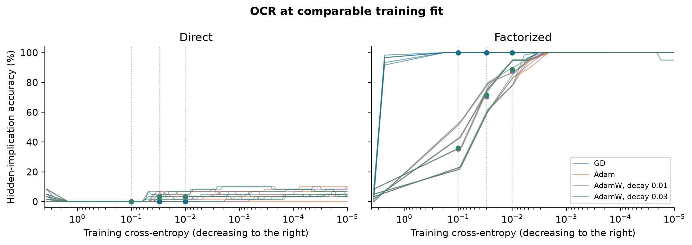

# When Does Factorization Enable OCR?

An optimizer stress test | Controlled fixed-attention experiment | October 10, 2026

## 1. Question

At comparable training cross-entropy, does the advantage of a factorized output-value map persist under full-batch gradient descent (GD) and Adam? Does decoupled weight decay change that advantage? This project follows the fixed-attention setting of Huang et al. [1], rather than reproducing their complete transformer experiments. The paper already reports AdamW use; this is not a first test of OCR under AdamW.

## 2. Setup

We use 20 fact groups, four subjects per group, and one subject per group with an observed implication: 80 facts plus 20 implications for training; 60 hidden implications for testing; 40 candidate answers. Subjects have opaque, permuted one-hot IDs. Inputs are x = e_s + e_r. We compare logits Wx with AB<super>T</super>x. W is 40 x 82; the factor width is 40, sufficient to represent every such W, so there is no hard rank restriction.

For each of five seeds (0-4), W0 has independent N(0, 0.01<super>2</super>) entries. Its SVD gives balanced factors A = U sqrt(S), B = V sqrt(S). All conditions share the same initial function per seed. Training uses CPU float64, full batches and 20,000 updates. A separate seed-100 pilot (5,000 updates per candidate) selects the lowest final training CE among stable candidates: GD learning rate 1.0; Adam 0.01, for both parameterizations. AdamW inherits 0.01. All 12 pilot outcomes are saved; test performance is never evaluated in the pilot.

The main comparison has zero decay. AdamW additionally uses decay 0.01 and 0.03. Ten zero-decay AdamW runs check equivalence to Adam. We save the first crossing of training CE 0.1, 0.03 and 0.01, and the final checkpoint; training continues after crossing. All metrics use only active answer rows and input columns. Spectral metrics use output-row centering, Wc = W - row_mean(W).

## 3. Results

## 3. Results (continued)

| Condition | Direct OCR | Factorized OCR | Reached CE <= 0.01 |
|---|---|---|---|
| GD | 0.0% | 100.0% | 5/5 and 5/5 |
| Adam | 3.0% | 87.7% | 5/5 and 5/5 |
| AdamW, decay 0.01 | 3.0% | 87.7% | 5/5 and 5/5 |
| AdamW, decay 0.03 | 3.3% | 88.7% | 5/5 and 5/5 |

Table 1. Mean hidden-implication accuracy across five seeds at the first CE <= 0.01 checkpoint. Figure 2 in the repository shows every seed at matched fit and at the fixed update budget; Figure 3 relates centered spectral ratio to OCR at matched fit.

<b>Observation 1.</b> At matched fit, factorized GD reaches 100.0% OCR and factorized Adam 87.7%; direct GD reaches 0.0% and direct Adam 3.0%. These comparisons control initial predictions and attained training loss, but not optimizer step size or parameter-space geometry.

<b>Observation 2.</b> With AdamW decay 0.01 / 0.03, factorized OCR is 87.7% / 88.7%, versus 3.0% / 3.3% for direct models. At 20,000 updates, factorized Adam reaches 100.0% and direct Adam 6.3%. Matched-fit and fixed-budget results answer different questions.

<b>Observation 3.</b> At CE <= 0.01, mean centered nuclear/Frobenius ratio for factorized GD is 4.287, compared with 4.121 for factorized Adam. This statistic is scale invariant; its square is one definition of spectral effective dimension. Similar OCR need not imply identical learned spectra. The five seeds, not individual time checkpoints, are the replication units.

## 4. Interpretation

Factorization helps under both GD and Adam, but Adam has a 12.3 percentage-point OCR deficit at CE <= 0.01 that disappears with continued training. Adam also has the lower spectral ratio at this checkpoint: lower ratio does not imply better OCR. This is an association, not a causal mechanism. The code records margins and ||Wc||*/gamma for positive minimum training margin gamma, allowing comparisons at unit training margin.

The nuclear-norm account in [1] motivates this analysis, but no numerical SVM reference or closed-form solution alignment is computed here. Nonzero AdamW decay changes regularization as well as dynamics. Decaying both factors by (1 - learning_rate * decay) shrinks their product by the square of that factor, whereas direct W receives a single factor. Equal decay coefficients therefore do not match functional shrinkage.

## 5. Limitations

Attention is fixed; the data are small, noiseless and structurally balanced. Five initialization seeds use one fixed data mapping, and the pilot uses one separate seed with a limited learning-rate grid. First-crossing CE ranges from 0.00964 to 0.01000 at the 0.01 target, so fit is approximate. Finite-step GD and random matched initialization differ from asymptotic or symmetry assumptions in theory. There is no intervention proving causality, no theorem verification, and no evidence here about realistic LLM hallucination. Conclusions are restricted to this setup.
